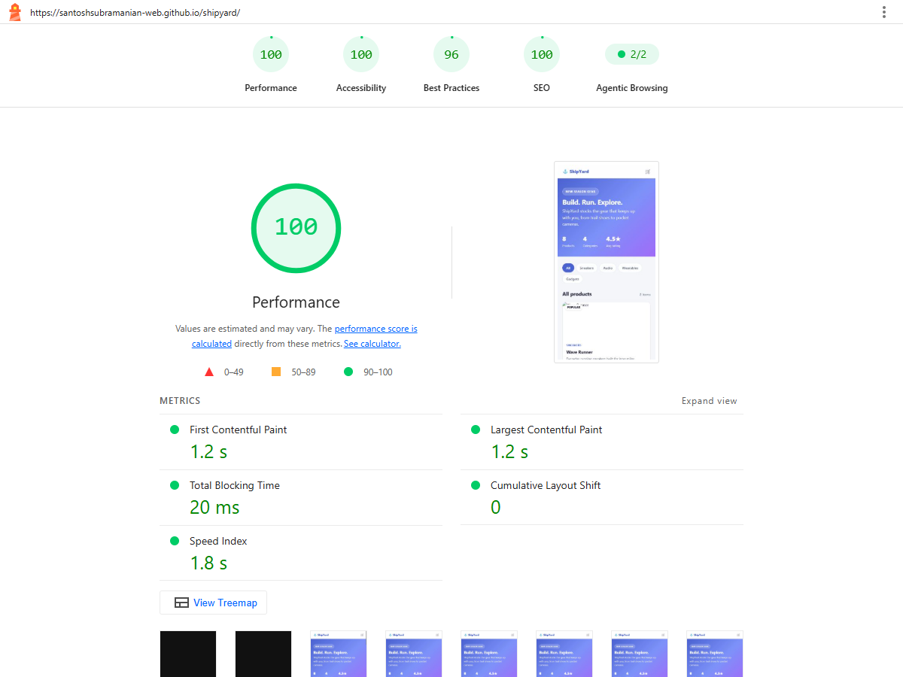

# ShipYard

A product-catalog storefront built with Next.js + TypeScript.

- Live site: https://santoshsubramanian-web.github.io/shipyard/
- Lighthouse Performance: 100 (mobile)



## Run locally

```bash
npm install
npm run dev
```

## What it does

Browse a product grid and open a detail page for each product. Optimized with next/image, next/font, lazy loading, and per-page metadata.

## Resilient States & Performance

- **Lighthouse Performance 90+ (Scored 100/100)**: Pre-rendered static generation, zero layout shifts with Next.js Image, eager loading on Largest Contentful Paint (`priority` prop), self-hosted Google Fonts via `next/font`, and dynamic lazy-loading for heavy reviews components.
- **Loading State (`app/loading.tsx`)**: Automatic loading feedback with responsive skeleton status.
- **Error Boundary (`app/error.tsx`)**: Client component error boundary catching runtime errors with retry (`reset()`) capability.
- **Not Found State (`app/not-found.tsx`)**: Friendly 404 handler for missing or out-of-stock items.
- **Deployment**: Static export (`output: "export"`) hosted live on GitHub Pages at `https://santoshsubramanian-web.github.io/shipyard/`.
